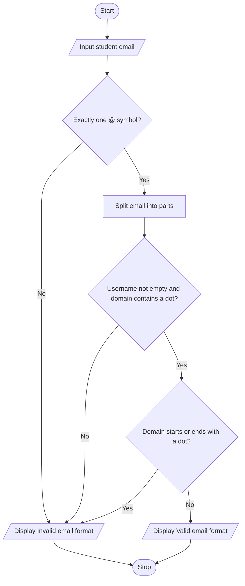

# Task 6: Student Email Validation

## 1. Aim

To develop a Python program to validate a student's email address using string operations and conditional statements.

## 2. Objective

The objective of this program is to check whether a student's email address follows a basic email format. The program verifies the presence of exactly one `@` symbol, a non-empty username, and a domain containing a dot.

## 3. Problem Statement

Write a Python program that accepts a student's email address as input and checks its basic format. If the email satisfies the specified conditions, display **"Valid email format"**; otherwise, display **"Invalid email format"**.

## 4. Concepts Used

- Variables and strings
- Input and output statements
- Conditional statements (`if`, `else`)
- String methods such as `count()`, `split()`, and `startswith()`
- Logical operators
- Nested conditional statements

## 5. Algorithm

1. Start the program.
2. Read the student's email address.
3. Check whether the email contains exactly one `@` symbol.
4. If not, display "Invalid email format".
5. Otherwise, split the email into username and domain parts.
6. Check whether the username is not empty and the domain contains a dot.
7. Check whether the domain starts or ends with a dot.
8. If all the required conditions are satisfied, display "Valid email format".
9. Otherwise, display "Invalid email format".
10. Stop the program.

## 6. Pseudocode

```text
START
    INPUT email

    IF email contains exactly one "@"
        SPLIT email into parts

        IF username is not empty AND
           domain contains "."
            
            IF domain does not start or end with "."
                DISPLAY "Valid email format"
            ELSE
                DISPLAY "Invalid email format"
            END IF

        ELSE
            DISPLAY "Invalid email format"
        END IF

    ELSE
        DISPLAY "Invalid email format"
    END IF
STOP
```

## 7. Python Program

```python
# Task 6: Student Email Validation

email = input("Enter student email: ")

if email.count("@") == 1:
    parts = email.split("@")

    if parts[0] != "" and "." in parts[1]:
        if not parts[1].startswith(".") and not parts[1].endswith("."):
            print("Valid email format")
        else:
            print("Invalid email format")
    else:
        print("Invalid email format")
else:
    print("Invalid email format")
```

## 8. Sample Output

### Example 1: Valid Email

```text
Enter student email: student@gmail.com
Valid email format
```

### Example 2: Invalid Email

```text
Enter student email: studentgmail.com
Invalid email format
```

### Example 3: Invalid Email

```text
Enter student email: @gmail.com
Invalid email format
```

### Example 4: Invalid Email

```text
Enter student email: student@.com
Invalid email format
```

## 9. Flowchart



## 10. Result

The program successfully checks a student's email address against the specified basic format conditions. It displays "Valid email format" when the conditions are satisfied and "Invalid email format" when any condition fails.

## 11. Conclusion

This task demonstrates how Python string methods and conditional statements can be used to perform basic email format validation. It helps develop logical thinking and an understanding of nested conditions. This program performs a basic format check and does not guarantee that an email address exists or is fully valid according to all email standards.
